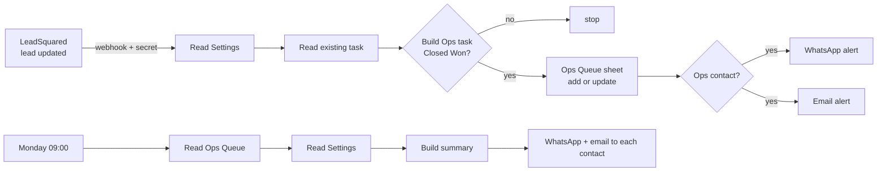

# How it works

## The flow

All the business rules live in one file, `handoff.js`. `build.js` copies it into the workflow's Code nodes, so the
rules that are tested are the same ones that run.

## Ready-by rule

Working days are Monday to Friday. Public holidays are ignored for now.

| Move-in day | Room ready by | If the request arrives after that |
|---|---|---|
| Tue | previous Fri 18:00 | `Already late` |
| Wed | Mon 18:00 | `Already late` |
| Thu | Tue 18:00 | `Already late` |
| Fri | Wed 18:00 | `Already late` |
| Sat / Sun / Mon | previous Fri 12:00 | Saturday 12:00 slot (`Late request → Saturday slot`); if that has passed too, `Already late` |

All times are India time (IST), computed explicitly. n8n's code runner keeps time in UTC even when the server is set to
IST, so the code never relies on the server clock's timezone.

## Flags

A task is always written, even when something is wrong, and the problem is spelled out in the `Flags` column and the alert:

| Flag | Meaning |
|---|---|
| `Missing: move-in date, sales owner` | Required fields Sales didn't fill in at Closed Won |
| `No date – chase Sales` | No usable move-in date, so no Ready-by is possible |
| `Already late` | The request arrived after the room should already have been ready |
| `Late request → Saturday slot` | Arrived after Friday noon for a Sat/Sun/Mon move-in |
| `No Ops contact for wing B` | Nobody in Settings to alert, so the row is written without a message |

Impossible dates (like 31/2) are treated as missing rather than quietly rolled over to another day. Slash dates are read
day-first (Indian format).

## When the same lead comes in again

The workflow matches on the LeadSquared lead ID.

- **It updates the row** and sends an alert starting with `Updated:`.
- **Ops' Status is never overwritten.** A room marked `Ready` stays `Ready`.
- **Waiting time counts from the first arrival.**
- **Lateness is judged from when Ops first heard about that move-in date.** If Sales fixes a phone number on Friday
  afternoon, an on-time Monday move-in doesn't turn "late".

## Monday summary

- **Who it covers:** only open tasks (`Pending Move In` or `Not Ready`).
- **What it counts:** move-ins in the next 14 days, overdue rooms (Ready-by passed), and tasks with no date.
- **Who's at the top:** the three tasks waiting longest.

It goes to every Ops contact listed in Settings, as the agenda for the Monday review.

## What's real and what's sample

- **Real:** the workflow, the rules and their tests, and the secret-protected webhook.
- **Sample:**
  - Every lead is invented. `send-test.sh` posts a LeadSquared-shaped lead.
  - The LeadSquared field names (`ProspectID`, `mx_Wing`, `mx_Move_in_Date`, ...) are an assumption. To go live,
    capture one real webhook payload and change `fromLsq()` in `handoff.js`. It's the only place that knows those names.
  - WhatsApp uses Meta's free test number. Meta currently refuses sends until the account has billing set up, so email carries the demo; each WhatsApp step is set to continue on error.
    Settings has an `Email` column; a contact needs a WhatsApp number or an email. In production it would go through a WhatsApp provider such as WATI
    (`n8n-nodes-wati`, Send Template Message) with an approved message template.

## Files

| File | What |
|---|---|
| `handoff.js` | All rules: field mapping, Ready-by, flags, alert text, Monday summary |
| `handoff.test.js` | Fixed-date checks for every rule (`node handoff.test.js`) |
| `build.js` | Builds `workflow.json` with `handoff.js` inlined into the Code nodes |
| `workflow.json` | Import into n8n (no credentials inside) |
| `payloads/`, `send-test.sh` | Sample LeadSquared leads and the script that sends them |
