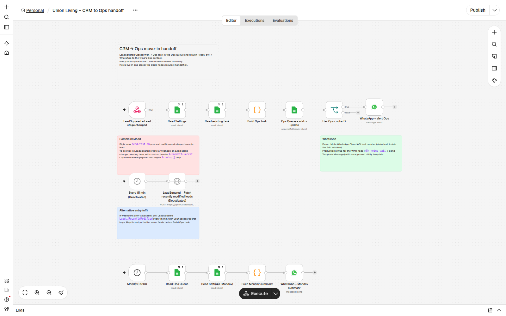
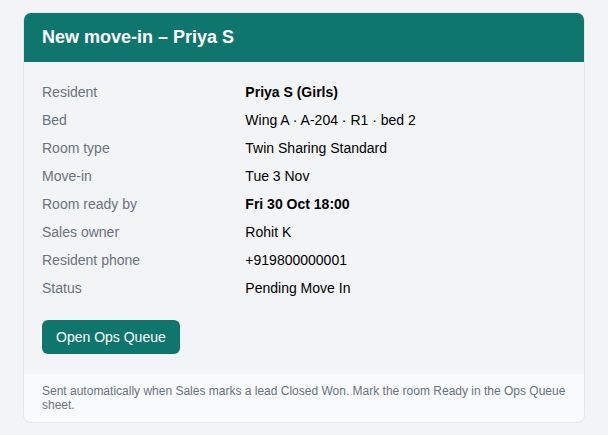
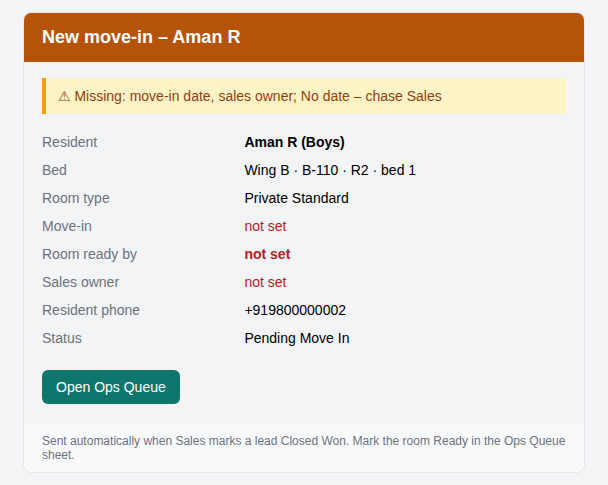
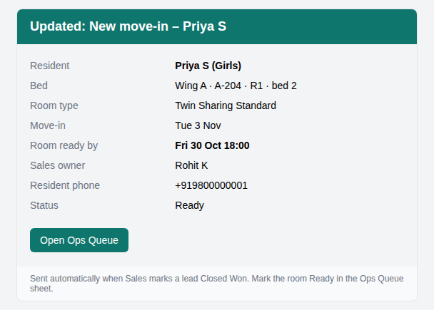
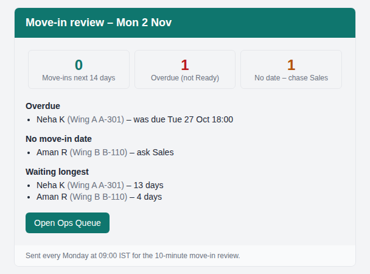

# CRM → Ops move-in handoff

A small n8n automation for a co-living operator. When Sales closes a booking in LeadSquared, Ops hears about it
within seconds (WhatsApp and email), with the date the room has to be ready. Every Monday morning there's a summary of what's coming
up and what's overdue.

## The problem

An allotment tracker had **65 residents stuck before move-in**: 29 marked Pending Move In and 36 marked Not Ready.
All 35 who had a move-in date were already past it, by 26 to 138 days.

The cause wasn't slow cleaning. It was the handoff:

- **Ops learns a room needs turning only when the resident arrives.** Nothing tells them when Sales closes the deal.
- **Friday-evening requests wait until Monday.**

The process fix proposed to the Heads of Sales and Ops was:

1. Closed Won creates an Ops task the same day.
2. Ops marks the room Ready 2 working days before move-in (by Friday noon for Saturday-to-Monday move-ins).
3. A 10-minute review every Monday of the next two weeks.

This workflow makes that process run without anyone having to remember it.

## What it does

1. A lead reaches **Closed Won** in LeadSquared, and LeadSquared calls the workflow.
2. The workflow checks what Ops needs (bed, move-in date, gender, sales owner, phone) and flags anything missing in plain words.
3. It works out **Ready-by**, the time the room must be ready ([rules](how-it-works.md#ready-by-rule)).
4. It adds the task to the **Ops Queue** Google Sheet, or updates it if the same lead comes in again.
5. It alerts that wing's Ops contact on WhatsApp and by email.
6. **Every Monday at 09:00 IST**, everyone listed gets the move-in review.

Ops closes the loop in the Sheet by changing Status: `Pending Move In → Ready → Moved In`. There's no new app to learn.

## What Ops receives

Real emails produced by the workflow from the sample leads.

### 1. A new move-in

Sent the moment Sales marks the lead Closed Won. The date Ops works to is **Room ready by**.

{ width="580" }

### 2. A flagged move-in

Sales left out the move-in date and owner. The task is still created, but the header turns orange,
the problem is spelled out first, and missing fields show as **not set**, so Ops chases Sales instead of guessing.

{ width="580" }

### 3. An update

Sales edited the lead later. Ops hears about it, and their progress is kept: the room is still **Ready**.

{ width="580" }

### 4. The Monday review

Every Monday at 09:00 IST: the agenda for the 10-minute move-in review.

{ width="580" }

WhatsApp gets the same content as plain text.

## Status

| Part | State |
|---|---|
| Rules (Ready-by, flags, Monday summary) | Built and tested, in Node and inside n8n |
| Workflow in n8n | Built, imported, webhook live with a secret header |
| Email alerts + Google Sheet end-to-end | Working: tested on 28 Oct with a real Sheet and Gmail (new lead, repeat lead, missing fields, Closed Lost, Monday review) |
| WhatsApp alerts | Wired and switched on. Meta refuses sends until the WhatsApp account has billing set up, so a failed WhatsApp never stops the email |
| Real LeadSquared connection | Sample payloads only. The field names are an assumption until one real payload is captured |

Next: [how it works](how-it-works.md) · [set it up](setup.md)
